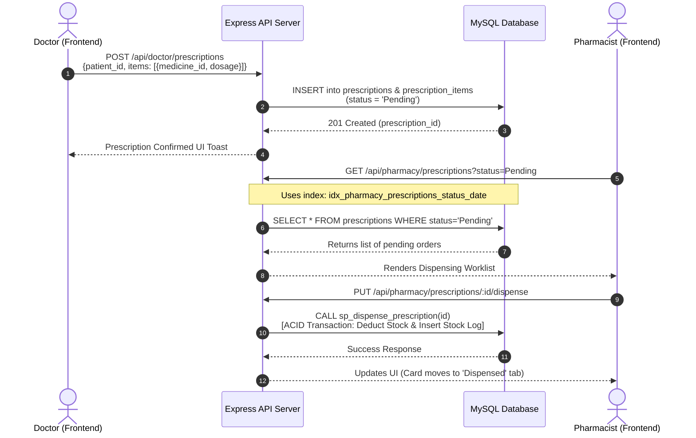

# Hospital Management System (HMS)
## Role-Based Features & Full-Stack Database Integration Guide

---

## 1. Executive Architecture Overview

The Hospital Management System operates on a modern, decoupled **3-tier enterprise architecture**:

```mermaid
flowchart TD
    subgraph Client ["Frontend Tier (Client - React 19 + Vite)"]
        UI["Role Dashboards & Views<br/>(Admin, Doctor, Pharmacist, Nurse, Receptionist, Patient)"]
        Axios["Axios HTTP Client<br/>(JWT Request Interceptor & Response Error Handler)"]
        State["React State & UI Controls<br/>(useState, useEffect, Tabs, DatePickers, Modals)"]
        UI --> State
        State --> Axios
    end

    subgraph Server ["Backend Tier (API Server - Node.js + Express)"]
        Routes["Express Router<br/>(/api/auth, /api/admin, /api/doctor, etc.)"]
        AuthMiddleware["Security & RBAC Middleware<br/>(verifyToken & checkRole)"]
        Controller["Route Controllers<br/>(Dynamic Query Builder, Input Validation)"]
        DBPool["MySQL Connection Pool<br/>(mysql2/promise, Prepared Statements)"]
        
        Axios -->|HTTPS / JSON + Bearer JWT| Routes
        Routes --> AuthMiddleware
        AuthMiddleware --> Controller
        Controller --> DBPool
    end

    subgraph Database ["Database Tier (MySQL 8.0 Engine)"]
        Tables["Relational Tables<br/>(users, patients, appointments, bills, etc.)"]
        Indexes["Role-Specific Composite Indexes<br/>(B-Tree Indexes for fast filtering)"]
        Proc["Stored Procedures & Triggers<br/>(ACID Transactions, Auto-audit, Inventory sync)"]
        Views["Database Views<br/>(vw_doctor_roster, vw_inventory_status, etc.)"]
        
        DBPool -->|SQL Queries & Bound Params| Database
        Database --> Tables
        Database --> Indexes
        Database --> Proc
        Database --> Views
    end
```

---

## 2. How the Database Integrates with the Frontend

The integration between the MySQL database and the React frontend follows a strict 4-step pipeline that ensures type safety, sub-millisecond query execution, and high security:

### Step 1: User Action in Frontend (React)
- The user interacts with UI elements (e.g., clicks a status filter tab, selects a date range, enters a search keyword, or submits an admission form).
- React state (`useState`) captures the parameters and invokes an asynchronous service call using the preconfigured Axios client ([`axios.js`](file:///c:/Users/Dimuthu/Desktop/hospital-management-system/frontend/src/api/axios.js)).
- **Axios Interceptor** automatically retrieves the logged-in user's JWT token from `localStorage` and injects it into the HTTP request headers:
  ```javascript
  headers: { Authorization: `Bearer ${token}` }
  ```

### Step 2: Request Authentication & Authorization (Express Backend)
- The request reaches Node.js Express at a role-restricted route (e.g., `/api/doctor/appointments?status=Scheduled&date=2026-10-19`).
- Middleware verification:
  1. `verifyToken`: Decodes and validates the cryptographic JWT signature; extracts `user_id`, `username`, and `role`.
  2. `checkRole(['Doctor'])`: Verifies that the authenticated role matches the allowed permissions for that specific resource. If unauthorized, returns HTTP `403 Forbidden`.

### Step 3: Parameterized Database Query Execution (MySQL Connection Pool)
- The backend controller constructs a parameterized query using placeholders (`?`) to completely eliminate SQL Injection vulnerabilities.
- The query targets **specific database indexes** created for that role. For example, when filtering a doctor's appointments:
  ```sql
  SELECT a.*, p.first_name, p.last_name, p.patient_code 
  FROM appointments a
  JOIN patients p ON a.patient_id = p.patient_id
  WHERE a.doctor_id = ? AND a.appointment_date = ? AND a.status = ?
  ORDER BY a.start_time ASC;
  ```
- MySQL's query optimizer utilizes the composite B-Tree index:
  `idx_doctor_appointments_doc_date_status (doctor_id, appointment_date, status)`
  This bypasses full-table scans, performing an instant index seek directly to the matching records.

### Step 4: Stored Procedures, Triggers & Response Deserialization
- For multi-step operational writes (such as dispensing medicines, discharging patients, or creating invoices), the backend calls **MySQL Stored Procedures** wrapped in ACID transactions (`START TRANSACTION ... COMMIT / ROLLBACK`).
- **Triggers** automatically fire inside the database to update inventory stock quantities or write audit trail records in `audit_logs`.
- The MySQL driver deserializes raw rows into JavaScript JSON objects and returns them with appropriate HTTP status codes (`200 OK`, `201 Created`).
- The React frontend receives the JSON payload, triggers a state re-render, and updates tables, cards, and modal dialogs with smooth animations.

---

## 3. Role-by-Role Features & Database Integration Details

---

### Role 1: Administrator (Hospital Operations & Governance)

The Administrator oversees hospital infrastructure, staffing, security audit trails, and system-wide operational metrics.

#### Key Features:
1. **Executive Operations Dashboard**: Real-time KPI summary showing total active doctors, nurses, registered patients, daily appointment volume, pending bills, and bed occupancy.
2. **Staff Management & Directory**: Complete directory of all clinical and administrative staff with filtering by department, clinical role, and active/inactive status.
3. **Staff Status Control**: Instant toggle switch enabling or disabling staff accounts without deleting operational history.
4. **System Audit Logs**: Real-time inspection log tracking every sensitive action (`LOGIN`, `CREATE_USER`, `UPDATE_PATIENT`, `DELETE`, `DISPENSE`) with keyword and date range filters.
5. **Departmental Administration**: Management of hospital wards, consultation fees, and operational units.

#### Database Integration Mapping:
- **Index Utilized**: `idx_admin_users_role_status (role, is_active)`
  - **Endpoint**: `GET /api/admin/users?role=Doctor&is_active=1`
  - **SQL**: `SELECT user_id, username, email, role, is_active FROM users WHERE role = ? AND is_active = ?`
  - **Purpose**: Powers user management lists with instant role and active-status filtering.
- **Index Utilized**: `idx_admin_staff_dept_status (department_id, status)`
  - **Endpoint**: `GET /api/admin/staff?department_id=2&status=Active`
  - **SQL**: `SELECT s.*, d.department_name FROM staff s JOIN departments d ON s.department_id = d.department_id WHERE s.department_id = ? AND s.status = ?`
  - **Purpose**: Optimizes staff roster searches across specialized hospital departments.
- **Index Utilized**: `idx_admin_audit_action_date (action, created_at)`
  - **Endpoint**: `GET /api/admin/audit-logs?action=UPDATE_STATUS&start_date=2026-10-01&end_date=2026-10-19`
  - **SQL**: `SELECT * FROM audit_logs WHERE action = ? AND created_at BETWEEN ? AND ? ORDER BY created_at DESC LIMIT 150`
  - **Purpose**: Rapid retrieval of security audit trails without scanning the entire history table.
- **Index Utilized**: `idx_admin_appointments_date_status (appointment_date, status)`
  - **Endpoint**: `GET /api/admin/dashboard`
  - **SQL**: `SELECT COUNT(*) FROM appointments WHERE appointment_date = CURDATE() AND status = 'Completed'`
  - **Purpose**: Immediate aggregation for the admin dashboard KPI cards.

---

### Role 2: Doctor (Clinical Practice & Consultations)

The Doctor manages outpatient consultations, Electronic Medical Records (EMR), patient diagnostic histories, and digital prescriptions.

#### Key Features:
1. **Clinical Appointments Desk**: Interactive calendar and queue with tabs (`Scheduled`, `In-Progress`, `Completed`, `Cancelled`) and patient name search.
2. **Status Progression Workflow**: One-click actions to advance appointments from `Scheduled` &rarr; `In-Progress` &rarr; `Completed`.
3. **Comprehensive EMR Patient History**: Longitudinal clinical timeline displaying past diagnoses, vital signs, allergies, lab findings, and historical prescriptions for any selected patient.
4. **Digital Prescription Builder**: Interactive form allowing doctors to prescribe multiple medications with exact dosage, frequency, and duration instructions.
5. **Consultation Duty Roster**: Weekly availability scheduler with live toggles (`Available` / `Off-Duty`) per day of the week.

#### Database Integration Mapping:
- **Index Utilized**: `idx_doctor_appointments_doc_date_status (doctor_id, appointment_date, status)`
  - **Endpoint**: `GET /api/doctor/appointments?date=2026-10-19&status=Scheduled&search=John`
  - **SQL**: `SELECT a.*, p.first_name, p.last_name, p.patient_code FROM appointments a JOIN patients p ON a.patient_id = p.patient_id WHERE a.doctor_id = ? AND a.appointment_date = ? AND a.status = ? ORDER BY a.start_time ASC`
  - **Purpose**: Ensures doctor's daily appointment queue renders instantly even with hundreds of hospital bookings.
- **Index Utilized**: `idx_doctor_medical_records_patient_date (patient_id, record_date)`
  - **Endpoint**: `GET /api/doctor/patient-history/:patientId`
  - **SQL**: `SELECT * FROM medical_records WHERE patient_id = ? ORDER BY record_date DESC`
  - **Purpose**: Powers patient timeline in the consultation room without latency.
- **Index Utilized**: `idx_doctor_prescriptions_doc_date (doctor_id, prescription_date, status)`
  - **Endpoint**: `GET /api/doctor/prescriptions?date=2026-10-19&status=Pending`
  - **SQL**: `SELECT pr.*, p.first_name, p.last_name FROM prescriptions pr JOIN patients p ON pr.patient_id = p.patient_id WHERE pr.doctor_id = ? AND pr.prescription_date = ? AND pr.status = ?`
  - **Purpose**: Tracks written prescriptions and pharmacy fulfillment status.
- **Index Utilized**: `idx_doctor_schedules_doc_day (doctor_id, day_of_week, is_available)`
  - **Endpoint**: `PUT /api/doctor/schedule/:id`
  - **SQL**: `UPDATE doctor_schedules SET is_available = ? WHERE schedule_id = ? AND doctor_id = ?`
  - **Purpose**: Fast schedule availability lookups and duty status toggling.

---

### Role 3: Pharmacist (Medication Dispensing & Inventory Control)

The Pharmacist controls pharmaceutical inventory, monitors stock reorder alerts, dispenses prescriptions ordered by doctors, and logs stock movements.

#### Key Features:
1. **Prescription Dispensing Queue**: Filterable list of doctor-prescribed orders with status tabs (`Pending`, `Dispensed`, `Cancelled`) and date range search.
2. **Prescription Details Modal**: Detailed breakdown of prescribed medications, strengths, dosages, duration, and doctor instructions.
3. **One-Click Dispense Action**: Dispenses medication while checking batch stock levels; automatically reduces inventory counts.
4. **Pharmaceutical Inventory Management**: Real-time medicine stock list with filter tabs:
   - **All Medications**
   - **Low Stock** (Stock $\le$ Reorder Threshold)
   - **Out of Stock** (Stock = 0)
5. **Stock Movement Audit Log**: Detailed chronological ledger displaying every restock, dispensing deduction, or manual stock adjustment for any selected medicine.

#### Database Integration Mapping:
- **Index Utilized**: `idx_pharmacy_prescriptions_status_date (status, prescription_date)`
  - **Endpoint**: `GET /api/pharmacy/prescriptions?status=Pending&date=2026-10-19`
  - **SQL**: `SELECT pr.*, p.first_name, p.last_name, s.first_name AS doc_first FROM prescriptions pr JOIN patients p ON pr.patient_id = p.patient_id JOIN staff s ON pr.doctor_id = s.staff_id WHERE pr.status = ? AND pr.prescription_date = ?`
  - **Purpose**: Keeps the pharmacy's urgent dispensing queue sorted and performant.
- **Index Utilized**: `idx_pharmacy_medicines_stock_reorder (stock_quantity, reorder_level)`
  - **Endpoint**: `GET /api/pharmacy/medicines?stock_status=low_stock`
  - **SQL**: `SELECT * FROM medicines WHERE stock_quantity <= reorder_level AND is_active = 1`
  - **Purpose**: Immediate identification of drugs requiring procurement restocking.
- **Index Utilized**: `idx_pharmacy_stock_log_med_date (medicine_id, created_at)`
  - **Endpoint**: `GET /api/pharmacy/stock-history?medicine_id=12`
  - **SQL**: `SELECT * FROM pharmacy_stock_log WHERE medicine_id = ? ORDER BY created_at DESC LIMIT 50`
  - **Purpose**: Powers the stock movement modal with audit histories for any drug.
- **Index Utilized**: `idx_pharmacy_presc_items_presc_med (prescription_id, medicine_id)`
  - **Endpoint**: `GET /api/pharmacy/prescriptions/:id`
  - **SQL**: `SELECT pi.*, m.name, m.stock_quantity FROM prescription_items pi JOIN medicines m ON pi.medicine_id = m.medicine_id WHERE pi.prescription_id = ?`
  - **Purpose**: Rapid lookup of multiple line items for a specific prescription order.

---

### Role 4: Receptionist (Front Desk, Patient Onboarding & Cashier Billing)

The Receptionist handles patient intake, appointment scheduling, billing invoice creation, and payment collection.

#### Key Features:
1. **Patient Registration & Directory**: Onboard new patients with demographics, emergency contacts, blood type, and insurance details. Filter by registration date and search by code or phone number.
2. **Hospital Appointments Desk**: Book patients with doctors based on schedule availability, department, and time slot.
3. **Billing Invoice Manager**: Generate bills for consultations, lab procedures, or ward charges with automatic subtotal calculation and tax adjustments.
4. **Billing Status Tabs**: Filter invoices by `Pending`, `Partially Paid`, and `Paid` with date range filters.
5. **Cashier Payments Register**: Dedicated payments ledger displaying all payment transactions with filters by payment method (`Cash`, `Card`, `Insurance`, `Online`) and date.

#### Database Integration Mapping:
- **Index Utilized**: `idx_reception_patients_reg_date (created_at, is_active)`
  - **Endpoint**: `GET /api/receptionist/patients?reg_date=2026-10-19&search=Doe`
  - **SQL**: `SELECT * FROM patients WHERE DATE(created_at) = ? AND is_active = 1`
  - **Purpose**: Fast retrieval of newly registered patients during morning intake rush.
- **Index Utilized**: `idx_reception_bills_patient_status (patient_id, payment_status)`
  - **Endpoint**: `GET /api/receptionist/bills?patient_id=45&status=Pending`
  - **SQL**: `SELECT b.*, p.first_name, p.last_name FROM bills b JOIN patients p ON b.patient_id = p.patient_id WHERE b.patient_id = ? AND b.payment_status = ?`
  - **Purpose**: Quickly surfaces outstanding invoices when a patient arrives at the front cashier.
- **Index Utilized**: `idx_reception_bills_status_date (payment_status, bill_date)`
  - **Endpoint**: `GET /api/receptionist/bills?status=Pending&start_date=2026-10-01&end_date=2026-10-19`
  - **SQL**: `SELECT * FROM bills WHERE payment_status = ? AND bill_date BETWEEN ? AND ? ORDER BY bill_date DESC`
  - **Purpose**: Powers revenue collection worklists and invoice aging reports.
- **Index Utilized**: `idx_reception_payments_date_method (payment_date, payment_method)`
  - **Endpoint**: `GET /api/receptionist/payments?payment_method=Card&date=2026-10-19`
  - **SQL**: `SELECT p.*, b.bill_number, pt.first_name, pt.last_name FROM payments p JOIN bills b ON p.bill_id = b.bill_id JOIN patients pt ON b.patient_id = pt.patient_id WHERE p.payment_method = ? AND DATE(p.payment_date) = ?`
  - **Purpose**: Accelerates end-of-day register reconciliation and batch card settlement.

---

### Role 5: Nurse (Inpatient Ward Care & Bedside Triage)

The Nurse oversees inpatient bed assignments, monitoring admissions, recording vital signs, and coordinating diagnostic lab orders.

#### Key Features:
1. **Inpatient Admissions Census**: Monitor currently admitted patients with status filtering (`Active`, `Discharged`, `Transferred`) and admission date ranges.
2. **Interactive Ward Bed Matrix**: Visual grid of all hospital beds by ward (General, ICU, Emergency, Pediatric) with real-time status indicators (`Available`, `Occupied`, `Maintenance`).
3. **Bed Status Quick-Toggle**: Ability to switch bed states (e.g., mark a bed `Maintenance` for sanitation after a discharge).
4. **Bedside Lab Requests Worklist**: Manage diagnostic tests ordered for patients with urgency buttons (`Critical`, `Urgent`, `Normal`) and status filters (`Pending`, `Sample Collected`, `Completed`).
5. **Vitals Recording**: Rapid entry of blood pressure, temperature, pulse rate, oxygen saturation, and clinical notes.

#### Database Integration Mapping:
- **Index Utilized**: `idx_nurse_admissions_status_date (status, admission_date)`
  - **Endpoint**: `GET /api/nurse/admissions?status=Active&start_date=2026-10-01&end_date=2026-10-19`
  - **SQL**: `SELECT a.*, p.first_name, p.last_name, b.bed_number, w.ward_name FROM admissions a JOIN patients p ON a.patient_id = p.patient_id JOIN beds b ON a.bed_id = b.bed_id JOIN wards w ON b.ward_id = w.ward_id WHERE a.status = ? AND a.admission_date >= ?`
  - **Purpose**: Delivers real-time inpatient census lists without table scans.
- **Index Utilized**: `idx_nurse_beds_ward_status (ward_id, status)`
  - **Endpoint**: `GET /api/nurse/wards?ward_id=3&bed_status=Available`
  - **SQL**: `SELECT b.*, w.ward_name FROM beds b JOIN wards w ON b.ward_id = w.ward_id WHERE b.ward_id = ? AND b.status = ?`
  - **Purpose**: Rapid bed availability discovery when admitting emergency patients.
- **Index Utilized**: `idx_nurse_lab_requests_status_prio_date (status, priority, request_date)`
  - **Endpoint**: `GET /api/nurse/lab-requests?priority=Critical&status=Pending`
  - **SQL**: `SELECT lr.*, p.first_name, p.last_name, lt.test_name FROM lab_requests lr JOIN patients p ON lr.patient_id = p.patient_id JOIN lab_tests lt ON lr.test_id = lt.test_id WHERE lr.status = ? AND lr.priority = ? ORDER BY lr.request_date ASC`
  - **Purpose**: Guarantees that life-threatening STAT and Critical lab tests appear at the top of the nurse's queue.
- **Index Utilized**: `idx_nurse_lab_requests_patient_status (patient_id, status)`
  - **Endpoint**: `GET /api/nurse/lab-requests?patient_id=88&status=Sample Collected`
  - **SQL**: `SELECT * FROM lab_requests WHERE patient_id = ? AND status = ?`
  - **Purpose**: Bedside lookup of pending lab tests for a specific patient.

---

### Role 6: Patient (Self-Service Health Portal)

The Patient portal enables individuals to view their health metrics, book consultations, review lab results, and inspect prescriptions.

#### Key Features:
1. **Patient Health Dashboard**: Quick view of upcoming appointments, active prescriptions, recent blood work results, and unpaid bills.
2. **Appointment Booking & History**: Book consultations with specialized doctors and review appointment history categorized into `Upcoming`, `Completed`, and `Cancelled` with date filtering.
3. **Diagnostic Lab Reports**: Download and view verified test results with normal reference ranges and pathologist remarks.
4. **Digital e-Prescriptions History**: View active medications, dosage schedules, duration, and instructions from attending physicians.
5. **Billing & Invoices**: Review detailed fee breakdowns and payment receipts.

#### Database Integration Mapping:
- **Index Utilized**: `idx_patient_appointments_pat_date (patient_id, appointment_date, status)`
  - **Endpoint**: `GET /api/patient/appointments?status=Scheduled&date=2026-10-25`
  - **SQL**: `SELECT a.*, s.first_name AS doc_first, s.last_name AS doc_last, d.department_name FROM appointments a JOIN staff s ON a.doctor_id = s.staff_id JOIN departments d ON s.department_id = d.department_id WHERE a.patient_id = ? AND a.appointment_date >= ? AND a.status = ?`
  - **Purpose**: Instant rendering of patient's upcoming and historical appointment cards.
- **Index Utilized**: `idx_patient_prescriptions_pat_date (patient_id, prescription_date)`
  - **Endpoint**: `GET /api/patient/reports` (e-Prescription list)
  - **SQL**: `SELECT pr.*, s.first_name AS doc_first, s.last_name AS doc_last FROM prescriptions pr JOIN staff s ON pr.doctor_id = s.staff_id WHERE pr.patient_id = ? ORDER BY pr.prescription_date DESC`
  - **Purpose**: Chronological timeline of patient medications and active courses.
- **Index Utilized**: `idx_patient_lab_requests_pat_date (patient_id, request_date)`
  - **Endpoint**: `GET /api/patient/reports?date=2026-10-15`
  - **SQL**: `SELECT lr.*, lt.test_name, lt.category, lt.normal_range FROM lab_requests lr JOIN lab_tests lt ON lr.test_id = lt.test_id WHERE lr.patient_id = ? ORDER BY lr.request_date DESC`
  - **Purpose**: Quick retrieval of patient laboratory reports and diagnostic history.

---

## 4. End-to-End Workflow Examples

### Workflow A: Prescription Creation & Pharmacy Dispensing



### Workflow B: Bed Allocation & Ward Admission

```mermaid
sequenceDiagram
    autonumber
    actor Nurse as Nurse (Frontend)
    participant API as Express API Server
    participant DB as MySQL Database

    Nurse->>API: GET /api/nurse/wards?ward_id=1&bed_status=Available
    Note over API,DB: Uses index: idx_nurse_beds_ward_status
    API->>DB: SELECT * FROM beds WHERE ward_id=1 AND status='Available'
    DB-->>API: Available Bed list [Bed #101, Bed #104]
    API-->>Nurse: Bed Selection Dropdown Populated

    Nurse->>API: POST /api/nurse/admissions<br/>{patient_id, bed_id, diagnosis}
    API->>DB: START TRANSACTION;<br/>INSERT INTO admissions; UPDATE beds SET status='Occupied';<br/>COMMIT;
    DB-->>API: Admission Confirmed
    API-->>Nurse: Ward Inpatient Census Table Updated
```

---

## 5. Security and Data Integrity Safeguards

1. **Prepared Statements Everywhere**: All Express backend routes use parameter bindings (`?`). Dynamic strings are never concatenated directly into SQL text.
2. **Role-Based Access Control (RBAC)**: Endpoints reject requests if the JWT token role is not in the authorized whitelist, protecting patient records from unauthorized access.
3. **Database-Level Integrity**:
   - Foreign key constraints prevent orphaned records (`ON DELETE RESTRICT`).
   - `ENUM` validation guarantees valid statuses (`Active`, `Discharged`, `Pending`, `Dispensed`).
   - Check constraints enforce positive stock numbers (`stock_quantity >= 0`).
4. **Immutable Audit Trails**: Actions across all roles trigger inserts into `audit_logs`, enabling compliance audits.

---

## Summary of Completed Files

- **Database Schema**: [`hospital_db.sql`](file:///c:/Users/Dimuthu/Desktop/hospital-management-system/database/hospital_db.sql) (All 23 role-specific indexes + stored procedures + triggers).
- **Backend API Routes**:
  - Admin: [`backend/routes/admin.js`](file:///c:/Users/Dimuthu/Desktop/hospital-management-system/backend/routes/admin.js)
  - Doctor: [`backend/routes/doctor.js`](file:///c:/Users/Dimuthu/Desktop/hospital-management-system/backend/routes/doctor.js)
  - Pharmacist: [`backend/routes/pharmacy.js`](file:///c:/Users/Dimuthu/Desktop/hospital-management-system/backend/routes/pharmacy.js)
  - Receptionist: [`backend/routes/receptionist.js`](file:///c:/Users/Dimuthu/Desktop/hospital-management-system/backend/routes/receptionist.js)
  - Nurse: [`backend/routes/nurse.js`](file:///c:/Users/Dimuthu/Desktop/hospital-management-system/backend/routes/nurse.js)
  - Patient: [`backend/routes/patient.js`](file:///c:/Users/Dimuthu/Desktop/hospital-management-system/backend/routes/patient.js)
- **Frontend Views**:
  - Admin: [`AdminAuditLogs.jsx`](file:///c:/Users/Dimuthu/Desktop/hospital-management-system/frontend/src/pages/admin/AdminAuditLogs.jsx), [`AdminStaff.jsx`](file:///c:/Users/Dimuthu/Desktop/hospital-management-system/frontend/src/pages/admin/AdminStaff.jsx)
  - Doctor: [`DoctorAppointments.jsx`](file:///c:/Users/Dimuthu/Desktop/hospital-management-system/frontend/src/pages/doctor/DoctorAppointments.jsx), [`DoctorPrescriptions.jsx`](file:///c:/Users/Dimuthu/Desktop/hospital-management-system/frontend/src/pages/doctor/DoctorPrescriptions.jsx)
  - Pharmacist: [`PharmacyInventory.jsx`](file:///c:/Users/Dimuthu/Desktop/hospital-management-system/frontend/src/pages/pharmacy/PharmacyInventory.jsx), [`PharmacyPrescriptions.jsx`](file:///c:/Users/Dimuthu/Desktop/hospital-management-system/frontend/src/pages/pharmacy/PharmacyPrescriptions.jsx)
  - Receptionist: [`ReceptionistBilling.jsx`](file:///c:/Users/Dimuthu/Desktop/hospital-management-system/frontend/src/pages/receptionist/ReceptionistBilling.jsx), [`ReceptionistPatients.jsx`](file:///c:/Users/Dimuthu/Desktop/hospital-management-system/frontend/src/pages/receptionist/ReceptionistPatients.jsx)
  - Nurse: [`NurseAdmissions.jsx`](file:///c:/Users/Dimuthu/Desktop/hospital-management-system/frontend/src/pages/nurse/NurseAdmissions.jsx), [`NurseLabTests.jsx`](file:///c:/Users/Dimuthu/Desktop/hospital-management-system/frontend/src/pages/nurse/NurseLabTests.jsx)
  - Patient: [`PatientAppointments.jsx`](file:///c:/Users/Dimuthu/Desktop/hospital-management-system/frontend/src/pages/patient/PatientAppointments.jsx), [`PatientReports.jsx`](file:///c:/Users/Dimuthu/Desktop/hospital-management-system/frontend/src/pages/patient/PatientReports.jsx)
